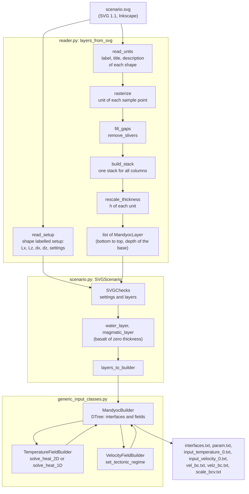
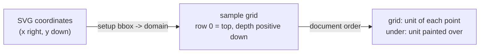
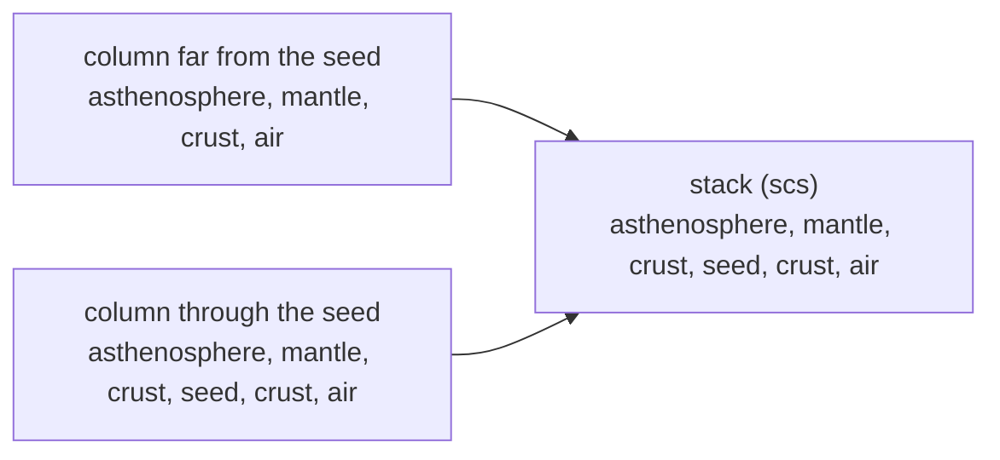
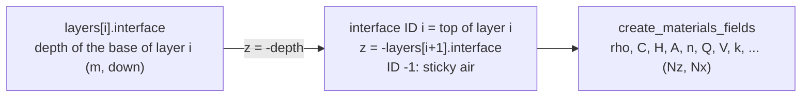

# SVG Scenarios

How `tapioca.inputs.svg` turns a drawing into the input files of Mandyoc. The reader
(`inputs/svg/reader.py`) builds the stack of layers from the SVG; `SVGScenario` (`inputs/svg/scenario.py`)
gives them to the generic builders (`inputs/generic_input_classes.py`), which build the fields and export the
files.

## Overview

## From shapes to sample points

`read_units` reads the object properties of each shape (Inkscape: *Object > Object Properties*). The first
line of the description is the rheology and the next lines are `key = value` (`C`, `rho` and `H` are
required; `h` is the reference thickness). Shapes with the same label are one unit; a shape without
description takes the one of the group (e.g. the Inkscape layer) that contains it.

`rasterize` maps the bounding box of the setup shape to the domain and samples the drawing on a grid of
`Nx` columns and rows of `sampling` (100 m by default). The shapes are painted in document order, as
Inkscape draws them, so each point gets the unit of the last shape that contains it. It also keeps the unit
painted over (`under`), which is the host of seeds and basins.

`fill_gaps` gives the points not covered by any shape the unit of the nearest covered point (first along the
row, then along the column). `remove_slivers` removes the thin layers left by shapes that overlap a little
(thinner than `min_thickness` in every column, when the unit is thicker elsewhere).

## From columns to one stack of layers

Each interface of Mandyoc is a single line `z(x)`, so the same stack of layers must fit every column.
`build_stack` reads the units of each column from the bottom to the top and joins all the different sequences
with the shortest common supersequence (`scs`). A unit absent in a column gets zero thickness there:

Away from a body (seed, basin), its interfaces stay flat at the depth of the body, so that Mandyoc, which
interpolates the interfaces between the columns, draws a box and not a funnel.

`rescale_thickness` makes the drawing independent of the vertical scale: a unit with `h` is stretched by
`h / (its most common drawn thickness)`, so thinned regions keep their drawn proportion; bodies without `h`
follow the unit they are drawn over; bodies with `h` get that thickness and their host absorbs the difference.
The bottom unit (asthenosphere) fills the rest of the domain and can not have `h`.

## From the stack to the builders

The reader works with depths positive downwards (as the SVG); `layers_to_builder` converts them to the
convention of Mandyoc and of `MandyocBuilder`: z positive upwards, from `-Lz` at the base to `0` at the top,
and node `(0, 0)` at the bottom-left corner of the domain.

`SVGScenario` then uses the generic builders:

- **Temperature**: `TemperatureFieldBuilder` with the LAB (top of the asthenosphere) and the surface (top of the
  solid layers: below the sticky air, or below the water) given by their interface IDs;
  `apply_linear_temperature` and `solve_heat_2D` (default) or `solve_heat_1D`.
- **Velocity**: `VelocityFieldBuilder.set_tectonic_regime` with the regime (extension for rifting and accordion,
  compression), the moving boundary and the thickness with constant velocity; `conservate_veloc` removes the
  divergence at the top.
- **Files**: `MandyocBuilder` exports `interfaces.txt` (13 parameters per layer), `param.txt` (`set_params` with
  `SVGScenario.parameters`) and the temperature and velocity fields.
